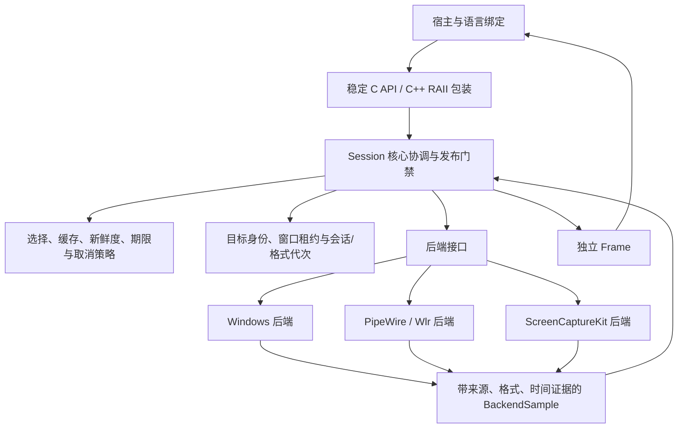

# maafw-screencap 抽取与扩展计划

日期：2026-10-26。状态：计划草案；本轮仅编写文档，尚未创建新项目、抽取实现或发布资产。

## 1. 项目定位与交付目标

新项目名固定为 **maafw-screencap**：从指定 MaaFramework 源码抽取桌面截图实现，提供可独立构建、集成、验证和分发的原生库。
先证明抽取没有引入非预期差异，再在明确分类、契约和回归保护下增加本库工作。

目标分为两部分：

1. **上游行为对齐**：保留固定上游拟纳入范围的截图能力、像素约定、默认行为和可观察副作用，并建立差异记录。
2. **本库额外工作**：实施必要的正确性修复，建立独立 SDK 契约，按需求增加可选能力，按测量结果选择性能优化。

“与上游对齐”不表示继承所有缺陷，也不表示公共 API 必须复刻整个控制器接口。
安全修复造成的有意差异须单列、验证和说明；不能一边修改行为，一边宣称无差异。

本项目不纳入输入控制、ADB/Android、PlayCover、识别/OCR、任务流水线、Agent、录制回放或 Qt 应用逻辑。
PipeWire Portal 会话等授权由宿主提供或通过明确的授权接口协作，不把截图失败恢复隐式变成重新选择来源。

建议首批原生构建目标为 Windows x64、Linux x64、macOS arm64；其他架构按独立 CI 与运行验收逐项增加。
“可编译”“能加载”“通过桌面捕获矩阵”分别报告，不合并为一个支持声明。

## 2. 固定来源、追溯与许可材料

| 项目 | 固定或记录方式 |
| --- | --- |
| MaaFramework | `0fc6025c2fc224a171b57d89505e8d47acd2a8b1`；本计划所有“上游”均指此提交，不指最新主线 |
| MaaUtils | 上述提交固定引用的 `f8994a38ddc6858800dfea8a04e958a0adbfb184` |
| OpenCV | 记录基线构建实际使用的版本、来源、模块和构建选项，作为颜色/ROI 等价性对照 |
| 系统与工具链 | 编译器、Windows SDK/macOS SDK、PipeWire/Wayland/libdrm、OS、架构及运行显示环境 |
| 当前 maa-capture | 仅参考已验证的额外保证与失败回归，不作为无修改上游来源 |
| b8d1550 与未合并补丁 | 只作历史材料；不得将已有移植差异或 PR #1587 当成固定上游已合入行为 |

建立 `upstream/manifest.json`，至少记录原始仓库、提交、原路径、文件 SHA-256、抽取后的路径、保留的函数/职责及差异编号。
维护可检查的适配/修复记录。任何进入产品的差异均应能回答：来源是什么、为何改变、属于哪类工作、如何验收。

固定上游的 [许可文件](https://github.com/MaaXYZ/MaaFramework/blob/0fc6025c2fc224a171b57d89505e8d47acd2a8b1/LICENSE.md)为 LGPL v3。
保留相关版权与许可材料，依实际版本登记第三方许可；源码与二进制分发同时准备来源、构建说明和必要的对应源码材料。
项目改名不改变被抽取材料适用的许可。

## 3. 命名与兼容边界

| 表面 | 建议名称 |
| --- | --- |
| 项目、SDK、CMake package | `maafw-screencap` |
| CMake 导出 target | `maafw-screencap::maafw-screencap` |
| 原生库 | `maafw-screencap.dll` / `libmaafw-screencap.so` / `libmaafw-screencap.dylib` |
| 公共头路径 | `include/maafw-screencap/` |
| C API / 宏前缀 | `Mfs` / `MFS_`，在 API 冻结评审前作为设计名称 |
| C++ 包装命名空间 | `maafw::screencap` |
| Python 分发名 / import | `maafw-screencap` / `maafw_screencap` |
| Rust package / crate | `maafw-screencap` / `maafw_screencap` |
| 其他绑定 | 使用一致项目名；仓库 URL、Go module、包发布位置在实际创建后确定 |

这是新项目，不直接继承旧库的软件版本、C ABI 2、多个历史创建入口或同名 DLL 搜索行为。
是否支持旧消费者另立兼容适配器和测试；没有明确兼容要求时，不把历史类布局带进新核心。
不直接替换现有应用锁文件、依赖哈希或正式运行库。

## 4. 抽取范围和源文件映射

| 范围 | 固定上游来源 | 纳入职责 | 特别记录 |
| --- | --- | --- | --- |
| Windows | `source/MaaWin32ControlUnit/Screencap/` | GDI、ScreenDC、PrintWindow、FramePool、DesktopDup、DesktopDupWindow | 后台/前台副作用、DPI、尺寸、格式、输出选择和原生等待 |
| Windows 状态辅助 | 同目录 PseudoMinimizeHelper、两个伪最小化 wrapper、HwndUtils；`Base/ForegroundUtils.h` | 伪最小化、恢复、前台尝试和冷却、窗口边界辅助 | 独立焦点观察不能遗漏；共享租约属于额外安全实现 |
| Linux PipeWire | `source/MaaLinuxControlUnit/Screencap/PipeWireScreencap.*` | 外部授权 fd/node、格式协商、缓冲映射、停流与回放 | 协商代次、有效长度/偏移、回调与错误唤醒 |
| Linux Wlr | 同目录 WlrScreencap；`Base/MemfdBuffer.*`；Wayland 客户端/辅助与截图协议 | 选择会话输出、共享内存和事件交互 | 输入协议裁剪必须记录；不能遗漏 stride、方向或代理失败 |
| macOS | `source/MaaMacOSControlUnit/Screencap/ScreenCaptureKitScreencap.*` | 按窗口/显示器获取图像、异步完成与像素转换 | point/pixel、权限、超时和晚到回调生命周期 |
| 管理器参考 | 各平台 Manager/Base 中的截图相关路径 | 构造、连接、选择、查询和停用的行为依据 | 不整体复制输入控制器与框架对象图 |

对 Windows 六种方式逐个保留，不把“只抽 FramePool”表述为完整截图实现抽取。
提取期间按最小变更调整命名空间、include、日志、时间与作用域工具；这些适配仍须审阅，不能假设天然等价。

## 5. 依赖策略

### 5.1 图像与公共依赖

第一阶段建议保留 OpenCV `core`/`imgproc` 所需路径作为私有依赖，以固定上游实际转换结果建立基线。
公共 API 不暴露 `cv::Mat`，后续可更换内部图像实现，但必须重新通过格式、stride、ROI、生命周期和异常边界的对照测试。
不在初始抽取阶段同时编写一套声称“完全等价”的颜色转换；已有 YUY2 全范围/视频范围偏差就是必须避免的反例。

参考构建使用固定 MaaUtils；产品侧先评估最小依赖目标，再决定保留最小部分或用有单独回归的本库适配替代日志、时间、作用域等工具。
不为减少依赖而删除原子同步、前台回退或错误信息。依赖升级单独提交、重新验证，发布材料记录实际解析版本。

### 5.2 平台依赖

- Windows：按实现显式链接 D3D11、DXGI、DWM、Win32/GDI、WinRT/COM 与所需缩放支持；FramePool 根据 SDK 和 API 能力探测。
- Linux：按后端探测 PipeWire、libdrm、wayland-client；协议生成产物或确定版本的生成工具随来源记录。
- macOS：ScreenCaptureKit、AppKit/ApplicationServices、CoreMedia/CoreVideo/CoreFoundation 等所需系统框架。

后端配置采用清晰的 AUTO/ON/OFF 语义：AUTO 可以关闭缺依赖后端并记录原因，显式 ON 缺依赖时配置失败。
运行时请求未编入或不支持的方式明确拒绝，不以无声占位实现冒充可用。

## 6. 架构设计

### 6.1 职责分层



- **后端层**：原生对象与线程、样本获取、格式、原生错误、缓冲归还；保留上游来源映射。
- **核心协调层**：不可变目标、身份/几何检查、候选事务、窗口状态、代次、所有权、错误和最终交付。
- **策略与接口层**：公共语义、能力协商，以及可选的后台、缓存、新鲜度、deadline/cancellation 等要求。

这是职责分层，不是 A/B/C 分类。后端层也必须有必要的安全修复；策略能力一旦启用，其正确性属于 B。

### 6.2 建议模块和目录

```text
maafw-screencap/
  CMakeLists.txt
  include/maafw-screencap/     # C ABI、类型和 C++ RAII 包装
  src/api/                   # C 边界、句柄和兼容转换
  src/core/                  # Session、Frame、错误、来源和交付门禁
  src/state/                 # 窗口协调、租约、观察器和代次
  src/policy/                # 选择、缓存、新鲜度、期限和取消
  src/backends/windows/
  src/backends/linux/
  src/backends/macos/
  src/support/               # 日志、受检算术、原生资源守卫
  upstream/reference/        # 固定来源参考，不作为公共接口导出
  upstream/manifest.json
  upstream/changes/          # 适配/修复记录及可重放差异材料
  bindings/                  # 按阶段交付的绑定和生成声明
  tests/unit/
  tests/contracts/
  tests/upstream-parity/
  tests/desktop/
  tests/consumer/
  benchmarks/
  cmake/
  scripts/
  docs/
```

在准备好已锁定依赖后，产品源码应能离线构建；构建说明列明依赖准备方式，不隐含承诺源码包包含所有系统 SDK。
完整源码包不能依赖开发者 Git 工作树、网络下载最新主线或未打包的生成材料。
CI 校验参考文件哈希、来源映射和所有产品差异的分类。文本差异校验辅助审查，行为等价仍由对应测试证明。

### 6.3 后端契约与单帧交付流程

私有后端接口按职责覆盖能力描述、open、capture、pause/resume 和 close；具体签名在 P1 原型中确定。
能力描述区分“已编入”“当前环境可用”“会触发授权/窗口副作用”和“支持哪些时间/取消证据”。
只读能力查询不能通过构造原生对象或试截图，意外触发权限 UI、焦点或窗口变化。
后端不得自行选择其他目标、隐式切换方法，或在返回失败后留下由核心无法接管的窗口修改。
后端返回有效样本、失败或有明确定义的无新样本状态；核心统一决定是否允许交付缓存，不把空图像当作全部状态。

一次捕获按以下顺序组织：

1. 校验 Session 状态，建立本次 Operation、取消代次和剩余预算；记录目标与相关代次。
2. 读取来源/几何快照。首次 Auto 选择时逐个试用候选并清理，正式激活后复验，不让试用帧直接越过门禁。
3. 在后端线程与资源规则内取得 BackendSample，附带实际证据；完成缓冲校验与所有权转移。
4. 再校验目标、相关代次、来源和几何。前后校验降低错误交付风险，但不宣称是 OS 原子截图事务。
5. 应用格式、缓存、新鲜度、错误失效和预算规则；身份或代次已失效时不以旧缓存兜底。
6. 将像素和同一次取样的元数据一起发布为独立 Frame；取消/失败路径归还本次资源，保存主要及清理错误。

正式首帧也走同一发布路径，避免 connect、普通 capture 和缓存分别维护三套校验。
各模块通过明确结果和状态转换协作，不用一组互相依赖的布尔标志推断会话状态；不为目录分层强制每层增加转发类或独立线程。
先在单个后端跑通该路径，再扩展共用接口，避免提前建立通用插件框架。

## 7. 核心对象、接口和所有权

### 7.1 核心对象

| 对象 | 职责和边界 |
| --- | --- |
| Runtime | 一份已加载库实例内的共享协调、后端能力与日志配置；生命周期明确 |
| CaptureTarget | 带类型的不可变目标：窗口、显示器、PipeWire、Wlr 或 custom；改变目标创建新 Session |
| CaptureOptions | 方法范围、明确的选择方式和策略；创建后不可变，不让测速期间配置突变 |
| Session | 一个宿主串行调用的捕获会话；跨 Session 仅对共享窗口状态等必要对象协调 |
| BackendSample | 后端取得的像素与取样时来源、格式、样本身份、时间证据和错误；公共层不自行猜 NEW |
| Frame | 像素和元数据一起拥有；下一次取图、停用及 Session 销毁不使已交付帧悬垂 |
| Operation / Cancellation | 单次操作的绝对截止时间和代次；取消请求可并发，不能滑移到后来启动的操作 |
| MonitorSnapshot | 若交付显示器枚举扩展，条目不可变，索引只表示本次快照，不替代来源身份 |

公共像素首版建议统一 BGR8，并同时报告 width、height、row_stride 和实际可读长度。
后端原格式与颜色转换信息保留内部记录；如果公开原格式，须增加明确的像素格式/色彩描述，不能继续让 channels 暗示全部语义。
桌面坐标、图像像素、内容矩形、缩放和旋转分别表达，不能把 point、DPI 逻辑单位和物理像素混用。

### 7.2 公共 API 与 ABI

建议以小而稳定的 C ABI 为唯一动态链接边界，使用区分类型的 opaque handle、固定宽度字段、UTF-8 和明确结果码。
C++ 提供基于 C ABI 的 RAII 包装，平台类、STL 布局和后端虚表保持私有，避免再次依赖自动导出全部 C++ 符号。

接口至少覆盖：运行时/ABI/能力查询、创建/连接、单帧捕获、Frame 查询/释放、暂停/资源释放/关闭、错误查询和自定义来源注册。
取消、新鲜度等可选功能使用统一 options/policy 设计，避免不断追加互相重叠的创建入口。

ABI 设计评审时确定结构前缀与 struct_size 读写规则：只访问调用者实际提供且本版本认识的字段，输出不超出缓冲；
字段扩展与 ABI 破坏分别处理，未知策略不得静默忽略。不要仅有 struct_size 却宣称未经验证的前向兼容。
软件 SemVer、C ABI 代际与后端行为版本分别记录，不继承旧库的数字。

所有 C/系统回调边界禁止 C++ 异常外泄。C API 的布尔或结果码宽度固定，绑定检查实际返回宽度，避免再次出现 Go 把寄存器高位当布尔结果的问题。

### 7.3 像素和回调协议

- 原生缓冲必须在 Unmap、Unlock、release_frame 或归还 producer 前完成必要复制或取得可证明的所有权。
- 自定义 provider 回调表复制保存；函数和 context 的保活责任到 Session 注销/关闭为止。
- 明确每次 capture 回调何时转交帧所有权：接管后所有成功、失败和异常路径恰好调用一次 release_frame；未接管时不误释放。注册部分成功时也能回滚。
- 公开 Frame 优先不可变。若绑定返回可写 bytes/Buffer/数组，使用独立副本，不能把对象外壳冻结等同于底层内存不可变。
- 引用计数只保证存活，不能证明缓存不会被调用者或后端的可写别名污染。先完成所有权回归，再考虑零复制或缓冲池。

库检查声明的尺寸、步长、长度、偏移和溢出；任意外部地址的真实可读性仍由调用者负责，不能用边界字段验证声称证明了指针背后的分配。

## 8. 并发、原生线程和窗口协调

Session 默认由一个宿主串行使用，允许不同 Session 由不同宿主线程操作。
取消信号单独支持并发；销毁是否可与其他调用竞争必须明确定义，首版不承诺并发销毁活动 Session。

Windows FramePool 在明确拥有 WinRT 资源的 MTA 执行通道中工作；PipeWire 遵循 thread-loop 的锁和回调纪律；
Wayland 事件队列拥有者固定；macOS 晚到完成使用独立保活状态。不同平台不强行套同一个线程模型。
用户回调和日志接收器不在持有全局协调锁时调用。
回调可在哪些线程执行、能否重入查询/捕获/关闭、何时保证不再调用 context，须作为接口契约和测试条件；首版拒绝未支持的重入。

共享注册表以一份已加载原生模块为边界，由 Runtime 引用持有；同模块多个 Runtime 也必须协调同一窗口身份，不能各自快照原状态。
WindowCoordinator 的要求包括：

1. 实际修改前记录原属性；多个租约共享原状态，恢复时只处理本库拥有的位/属性。
2. 检查 HWND、拥有进程/线程和已观察生命周期；失效代次不能恢复到替换窗口。
3. 独立观察目标激活，满足 A 的暂停取图恢复；按窗口共享状态，不按 helper 各建观察线程。
4. 恢复失败保留主要错误和清理错误，不把吞异常视为成功。

注册表锁只定位状态；Win32 调用、回调、线程 join 不在注册表锁内执行。
窗口状态锁、原生同步消息和退出等待必须画出调用/等待关系，覆盖目标属于宿主 UI 线程的场景。
先通过该场景的原型和停机回归，再冻结观察器实现；不以“加一把递归锁”替代设计，也不通过结束线程绕过恢复。
跨进程或另一份独立加载的库实例之间不自动共享租约，不能据此承诺全系统窗口所有权。

## 9. 生命周期、代次、采样和错误

### 9.1 生命周期语义

公开操作应区分以下含义，最终函数命名在接口评审中固定：

| 操作 | 建议语义 |
| --- | --- |
| connect/open | 建立或验证捕获会话，正式首样本可保留，但交付前必须复验 |
| pause/resume | 停止/恢复 producer 或取样；可保留 native 会话，明确哪些合法样本仍保留 |
| release resources | 释放捕获资源、使 pending/cache 和相关会话代次失效；再次捕获需明确的重建路径 |
| close/destroy | 终结对象，停止事件入口、等待安全退出、恢复本库临时状态，释放自身拥有资源 |
| get state | 快速读取逻辑状态，不通过查询暗中截图或修改窗口 |
| probe source（如提供） | 明确的来源有效性检查，与纯逻辑状态分开；说明可能的系统查询成本 |

上游 PipeWire inactive 是停流，不能把映射为 pause 的兼容入口偷偷改成“销毁会话”。
暂停后允许回放仍须遵守来源、格式、年龄和有效样本约束；release/close 后不能借旧帧伪装新会话成功。
不可重用的授权 fd 在失败或消费后不得自动回退到另一个来源。
PipeWire 授权 fd、Wayland 连接等外部资源逐项定义借用、复制或转移所有权，以及创建失败、重试和关闭时由谁释放。
默认方案优先保留宿主资源的所有权：可复制的句柄先复制，再由后端接管副本；不能复制的资源使用显式转移入口和失败归属规则。

### 9.2 代次与时间

区分 source 身份、native session、format 和 window mutation 的代次；只在对应事件发生时变化。
格式实际变化时废弃不再适用的旧帧；不能用新描述解释旧缓冲，也不能让晚到旧结果重新污染新状态。

交付序号与真实取样序号分开。重放保持原样本身份；内容是否变化、游戏渲染时间与库侧观察/完成时间不能互相推断。
时间采用明确时钟域和有效性标记；无法可靠映射或确认的取样时间保持未知。
fresh-only 需要可靠的“当前请求后取得新样本”证据，不能仅因转换完成时间晚于调用开始就宣称新鲜。

### 9.3 错误与预算

统一错误至少包括类别、阶段、后端、原生码及可读说明；主要失败与后续清理失败分别保存。
等待谓词识别 ready/failed/disconnected/cancelled，错误到达后唤醒，不能只改连接标志让宿主继续等超时。

deadline 从一次操作开始形成共享绝对截止时间，覆盖候选试用、正式激活、权限/可选配置等待和交付检查。
合作式等待按剩余预算退出；不能安全中断的 OS 调用在返回后拒绝晚到结果并进行清理。
操作预算与退出恢复耗时分别说明，不宣称 PrintWindow 等具有硬中断上限，也不把测试父进程超时等同于库取消。

## 10. A：固定上游行为对齐清单

| 行为 | 对齐要求及验收 |
| --- | --- |
| 伪最小化 | 保留透明/穿透且不激活还原的能力；暂停截图仍观察激活；目标前台即可恢复，不强制新输入 |
| 前台方法 | 核对激活、TOPMOST 回退和冷却；若加安全属性恢复，记录为 B 的有意差异 |
| FramePool | 保留清残留队列、有界等待及已有有效图像时的超时回放意图；新库的错误失效规则另列 B |
| PipeWire | 保留协商、取样请求、既有超时回放及 inactive 停流语义；不因 F2 改成默认禁止回放 |
| Wlr | 核对输出、协议流程、格式、行距和方向；从上游继承的缺陷以 B 修复，不能因此隐瞒差异 |
| Windows 几何/DPI | 核对原生调用环境、客户区与输出几何；默认是否移动/缩小窗口和严格拒收要独立决策 |
| macOS | 核对窗口/主显示器路径、过滤器、像素比例和异步失败；不能把 points 结果改名为 native pixels |
| 选择与默认值 | 保留自动测速意图，明确固定方法、组合、None/Auto 的新接口语义；不混用上游控制器和新库的数值默认值 |

A 的对照对象是固定源码和它的参考程序，不是 b8d1550，也不是当前库运行结果。
当前库作为回归来源时必须注明某个测试是在验证上游行为、本库新增保证还是历史缺陷。
像素、错误、时间、资源生命周期、窗口状态和副作用分别检查，不把一个“成功截图”当成全部对齐。

## 11. B：必要修复工作包

沿用现有改进清单编号，便于追踪；编号不是实现顺序。

| 工作包 | 必须兑现的条件 | 来源与性质 |
| --- | --- | --- |
| F1 实现适配 | 共享观察状态、租约、锁/退出协议、身份验证和恢复失败报告 | 安全实现 A，不要求复制上游线程结构 |
| F2 | 旧帧保留原 sample/时间，NEW/REUSED/UNKNOWN 与新鲜度一致 | 本库新增元数据契约的正确性 |
| F3 | Memfd 受检算术；PipeWire 有效长度、stride、offset、映射和格式约束 | 修复继承的安全边界缺口 |
| F4 | 重新协商后清除旧格式缓存，拒绝晚到旧代次帧 | 修复固定上游也存在的旧帧/新描述混用路径 |
| F5 | YUY2 恢复到固定上游调用的 OpenCV 像素结果 | 修复本库替换图像实现引入的偏差，不是性能优化 |
| B1 | 日志配置/并发/异常契约，析构与错误路径不因 sink 异常终止 | 本库基础设施正确性 |
| B2 | 共享预算、权限等待、错误唤醒和取消；按平台真实能力报告 | 已启用能力的契约完善 |
| B3 | 版本协商、必需协议、代理创建和移除处理 | 通用协议健壮性修复 |
| B4 | 按依赖版本与共享所有权配平 PipeWire init/deinit | 通用资源管理修复 |
| B5 | 部分回调注册、像素 pin/分配和原生拒绝时的回滚 | 本库绑定正确性 |
| B6 | 原生回调异常兜底，pw_buffer 恰当归还，失败及时通知宿主 | 通用回调/资源健壮性 |
| L1/O1 | 停流/停用/销毁及代次清晰；可写帧不污染缓存 | 本库生命周期和所有权契约 |

其他可迁移的必要修复包括 DXGI 映射有效期内复制、GDI 明确 DIB 格式/方向、FramePool 尺寸和裁剪复验。
这些修复是否已有各平台实机证据分别核对，不能将当前实现存在等同于新项目验收通过。

在默认数据路径内可触发的像素、越界、悬垂、缓冲遗失和错误吞没问题，必须在相应后端放行前解决。
不能以“先完全对齐”为由把危险实现作为产品默认路径发布；需要观察已知缺陷时使用安全替身或隔离参考进程。

## 12. 适合超出固定上游实现的工作

“领先”在这里指额外的可用保证或能力，不代表当前已证明跨平台更快、更稳定。

| 编号 | 建议工作 | 价值 | 是否可选及条件 |
| --- | --- | --- | --- |
| X1 | 显式目标、稳定身份范围、不可变快照及帧来源/几何元数据 | 避免捕获了错误来源还报告成功，便于多屏和应用映射 | 建议作为独立 SDK 核心；Windows/macOS 与 Linux 的身份保证分别表达 |
| X2 | 同窗口共享租约与事务恢复 | 防止重叠捕获相互快照污染、退出遗留透明状态 | 启用伪最小化/组合时必须安全，不能当作可选性能工作 |
| X3 | 候选逐个试用清理、正式重验、失败后回退及首帧保留 | 防止在受其他候选污染的状态下选出不可交付的方法 | 建议核心能力；测速次数、排序指标和激活顺序变化必须记录 |
| X4 | 带身份/格式/会话的缓存与采样元数据 | 静态画面可用，同时让消费者区分复用和实际取样 | 缓存策略可选；不能用回放掩盖设备、权限、来源错误 |
| X5 | 严格后台选择与方法行为查询 | 在构造/试用前过滤可能激活的方法 | 可选功能；不能抢焦点后再切回，用户自身激活不属库保证 |
| X6 | fresh-only、最大年龄和独立取消/总期限 | 宿主能控制是否接受旧样本及何时放弃操作 | 可选功能；启用后必须完成 B 的元数据和等待契约 |
| X7 | 结构化错误、限量事件、运行时与构建来源信息 | 定位候选拒绝、缓存失效、退出恢复和依赖身份 | 建议从第一阶段建立；公开诊断查询 API 可后置，不记录图像或敏感窗口文本 |
| X8 | SDK 独立消费、源码重建和资产 provenance | 让二进制、头文件、源码和绑定身份可核验 | 工程交付基础，不算截图算法创新 |
| X9 | 可选异步操作/持续流接口及有界背压 | 避免宿主 UI/Node 事件循环被同步 FFI 长时间阻塞 | 后续功能；先定义线程、回调、取消、丢帧和关闭契约，不能无限排队 |
| X10 | 可靠的损伤区域或内容变化证据接口 | 支持减少无意义识别和区分输入/渲染变化 | 研究与后续功能；无可靠证据时 UNKNOWN，不把 NEW 或序号递增当作内容更新 |

先交付 X1–X3、必要所有权与错误基础。X4–X6 按实际需求分阶段纳入；X9/X10 不作为首版阻塞项。
可选能力一旦对外宣称支持，就必须有对应 B 类正确性门禁，不能用“扩展”解释错误结果。

## 13. C：维护与经测量决定的性能优化

| 工作 | 实施前提 |
| --- | --- |
| M1–M3：格式、状态/锁说明、契约常量生成 | 手写与生成代码分开管理；不改变行为来换取短代码；声明与契约同源 |
| M4–M5：函数阶段拆分、测试诊断 | 必要错误因果和回归随 A/B 交付；维护整理不替代边界验证 |
| T1：减少完整帧复制、评估缓冲复用 | 先证明生命周期、可变别名和缓存隔离；保持 Unmap/release 前的必要保活 |
| T2：减少重复来源/拓扑查询 | 保留独立前后验证和失效拒绝，不能以全局 TTL 快照代替正确性门禁 |
| T3：FramePool 事件唤醒与共享观察调度 | 先保证不丢更新和退出安全，再比较 CPU、唤醒数、线程/句柄与延迟 |
| T4：冷启动与持续性能选择策略 | 固定负载测量连接、首帧、持续 p50/p95、采样年龄和资源成本；不宣称单样本排序证明整体最快 |
| 后续研究：共享采集 producer 或异步缓冲池 | 仅在实际负载证明收益后推进；来源、权限、会话隔离与慢消费者不能被共享机制削弱 |

基准报告固定来源、像素格式、分辨率、更新频率、策略、OS/驱动及工具链。
同时记录正确性结果；通过少校验、删必要复制、放宽像素判据或隐藏超时得到的数据不算等价条件下的性能提升。

## 14. 测试与验收设计

### 14.1 分层门禁

| 层级 | 门禁 | 证明范围 |
| --- | --- | --- |
| 来源与静态检查 | 固定文件哈希、差异分类、生成声明、导出符号、命名和版本 | 抽取材料与契约身份一致，不证明桌面行为 |
| 便携单元 | 受检算术、状态事务、代次、错误、取消竞争、策略和缓存失效 | 确定性逻辑与失败路径，不替代真实原生事件 |
| C ABI/绑定契约 | 布局/前缀尺寸、UTF-8、未知能力、回调失败、释放、Go 返回宽度、帧保活 | 实际原生边界与绑定一致 |
| 上游对照 | 相同输入下的像素、状态、默认值、副作用和明确差异 | 对固定基线逐项对齐或记录有意变化 |
| 平台桌面 | 自有窗口与输出、真实原生到帧/无更新、生命周期和资源 | 适用平台实际场景；不能跨平台外推 |
| SDK/分发消费 | 安装 SDK、解压消费、干净环境 wheel、完整源码包重建 | 发布资产实际可使用且身份一致 |

### 14.2 必须覆盖的场景

- 暂停所有库操作后激活伪最小化目标；直接读取 Win32 状态确认恢复，避免查询 API 顺带触发恢复而误通过。
- 无新输入的程序激活、切其他窗口、两种释放顺序、同窗口多个 Session、宿主 UI 线程及独立宿主线程。
- 原 layered/alpha/色键/flags、外部无关样式变化、目标销毁/替换、恢复失败及关闭竞争。
- 新样本、静态回放、未知时间、一次延迟更新、连接首帧、格式重协商、晚到旧帧和缓存错误失效。
- 短缓冲、stride/offset/乘法边界、代理创建失败、原生回调/分配异常、错误唤醒及缓冲归还。
- 取消/完成/下一次操作的竞争、权限等待、非协作调用晚到结果和退出恢复。
- YUY2 黑白电平/色条、通道顺序、行填充、方向、窗口/显示器几何、负坐标及 DPI/Retina 像素比例。
- 已交付帧跨下一次捕获、暂停、资源释放、格式变化、关闭仍有效；可写副本不污染缓存。

长流验证至少覆盖预热后的 120 秒，并记录帧/样本/复用/错误、延迟、线程、句柄或 fd、内存与图形资源。
20 次以上连接/配置/最小化恢复循环作为基础生命周期门禁；计数通过不替代缺陷所需的针对性回归。
游戏、独占全屏、跨 GPU、旋转、物理插拔/重排、权限边界等无环境时明确未验证。
本轮不使用 WSL 代替 Linux 验证；Linux/macOS 的桌面结果由对应原生环境提供。

## 15. 构建、绑定和交付

建议初始采用 C++20、CMake 3.28+；macOS 启用 Objective-C++，SDK/OS 最低版本按实际调用 API 和构建矩阵确认。
所有编译选项、依赖、include 和语言标准约束到 target；显式维护平台源列表，后端和测试开关有明确能力报告。
支持 add_subdirectory、安装导出与解压 SDK 消费，不污染宿主全局编译/链接设置。

首批交付 C/C++ 和 Python；Node.js、Rust、Go、Java、C# 按消费者需求分批加入。
从公共 C 契约生成类型/常量，函数与可选符号协商也要有一致性检查；不能把“类型生成”误当成整个 FFI 已自动验证。
默认关闭真实桌面测试，常规 CI 跑便携/契约与分发门禁；有条件的原生桌面任务单独运行并报告跳过原因。

初始 CI 覆盖三平台构建、关闭可选后端、最小/当前支持运行环境、SDK 消费、源码重建和已交付绑定的运行门禁。
Linux 构建依赖与最终运行依赖分别验证。Python wheel 优先按平台/架构分发，先明确系统 ABI 和外部依赖要求，
不因 ctypes 接口不依赖 Python C ABI 就把含原生库的包宣传成任意系统通用的纯 Python 包。

正式资产计划包括原生 SDK、完整源码、Python 分发物、构建清单、依赖/许可材料、provenance 和 SHA256SUMS。
来源信息关联新项目提交、固定上游提交、依赖与选项、原生库哈希和绑定版本；干净提交与开发 dirty 构建分开标识。
源码重建与干净环境消费以最终资产为输入，不从本地源码树偷偷补头文件或 DLL。

## 16. 分阶段实施与退出条件

| 阶段 | 交付 | 退出条件 |
| --- | --- | --- |
| P0：范围与决策 | 来源 manifest、命名、依赖锁定、差异分类、API/生命周期 ADR、测试矩阵 | 不再把默认值、所有权和授权前提留在隐含假设中 |
| P1：骨架与参考 | 原生构建骨架、固定上游参考程序、图像基线、C API 初稿与便携测试 | 三平台基本构建；参考与产品代码职责分明 |
| P2：逐后端抽取 | Windows、PipeWire/Wlr、ScreenCaptureKit 分别移植，A/B 按风险并行安排 | 每个已宣称可用后端的核心像素/资源/状态门禁通过，缺环境项单列 |
| P3：核心协调 | 共享窗口状态、来源/帧契约、候选事务、格式/会话代次、错误与安全退出 | 重叠、异常、暂停、关闭与旧帧污染回归通过；F1 的行为与安全实现共同验收 |
| P4：可选能力 | 按需求加入缓存/新鲜度、严格后台、deadline/cancellation 和诊断 | 每项有能力位、拒绝语义、默认值说明和对应 B 门禁 |
| P5：绑定与资产 | C/C++/Python 首批 SDK，后续绑定，源码/包消费及来源校验 | 所交付资产可独立使用，依赖和原生身份一致 |
| P6：测量与维护 | M 类整理、T 类测量和有收益的优化 | 无未经解释的行为回退；收益与成本可复核 |

P2/P3 之间可迭代，安全缺陷不必等所有后端抽完才处理；也不先发布含已知危险默认路径的“纯上游版”。
阶段标签不是承诺工期。每个 PR/提交尽量围绕一个后端、行为或契约，必要测试随同交付。

### 16.1 抽取和消费者迁移步骤

1. 从固定上游及其依赖重新取得文件、核对哈希，建立最小参考程序。当前库代码只作差异与回归资料，不作为批量改名后的新项目起点。
2. 每次抽取一个后端及直接依赖，先记录原行为，再做最小适配；必要修复采用独立差异条目，与对齐证据一起保存。
3. 用确定性输入比较像素与状态；真实桌面比较采用受控静态图或可识别帧标记，不能把不同时刻的动态截图要求为逐像素相同。
4. 对已通过门禁的后端接入核心与首批绑定，用新库名独立安装和加载；测试明确输出所加载库的路径、提交和哈希，避免误用旧 DLL。
5. 选一个实际消费者验证创建、捕获、权限、缓存、取消和退出；旧接口如需兼容，编写独立映射及行为差异表。
6. 新旧库在隔离测试中比较并保留回退方案；涉及同一窗口的伪最小化等修改时不要同时启用两库，因为它们不共享租约。
7. 只有新库相应平台与契约验收通过后，才在另一个集成任务中修改消费者依赖和锁文件。本计划不直接迁移现有应用。

### 16.2 主要风险与应对

| 风险 | 应对与放行边界 |
| --- | --- |
| 抽取、替换图像库和架构重写同时进行，差异无法归因 | 先保留转换路径，每个后端分离最小适配与修复，未通过像素对照不替换依赖 |
| UI 线程同步调用与观察器退出相互等待 | P1 优先验证线程原型；同步消息、锁和 join 的等待环未解决，不放行伪最小化能力 |
| 上游旧帧语义与新增新鲜度契约冲突 | 分开样本与交付身份，保持默认回放边界；缺乏证据时拒绝强新鲜度请求 |
| 平台授权、合成器、SDK 或显示环境缺失 | 能力分级报告，保留原生错误与未验证项；构建成功不升级为桌面支持声明 |
| 首版同时扩张到六语言、流接口和低复制实现 | 先交付 C/C++/Python 与核心门禁，按消费者需求追加，性能修改独立测量 |
| 消费者无意依赖旧版本的副作用或错误行为 | 用独立兼容适配和迁移表处理，不把兼容分支扩散到每个后端 |

## 17. 开始实现前的 ADR 清单

| 决策 | 建议起点 |
| --- | --- |
| 图像依赖 | 首期保留私有 OpenCV；公共 API 不绑定它；替换必须通过逐操作等价门禁 |
| 公共 ABI | C 为动态边界，C++ 为 RAII 包装；旧库兼容独立处理 |
| 方法选择 | 固定方法不静默换方式；Auto 与 None 用显式语义区分，数值和兼容映射单独确认 |
| 默认回放 | 不把上游已有回放删掉后当作对齐；缓存失效和元数据正确性必须先满足 |
| 生命周期 | pause、release、close 各自明确；旧 inactive 的兼容映射按后端记录 |
| 观察器与窗口线程 | 独立观察，统一协调；在宿主 UI 线程重入/停机原型通过后冻结调度方案 |
| 目标和几何 | 是否提供兼容选屏/移动窗口路径与严格来源路径；任何默认变化都有差异记录 |
| 授权 | 宿主与库的授权职责、是否允许请求 UI、权限等待与取消分别明确 |
| 首版范围 | 核心保证优先，先覆盖实际消费者；未启用能力拒绝，不静默按弱保证执行 |
| 版本与发版 | 软件版本、ABI、行为基线独立；仓库/包名占用在实际创建/发布前检查 |

## 18. 实施和后续上游同步规则

使用 Conventional Commits，纯格式、行为、正确性和性能修改分开；“对齐”提交引用固定来源及对应行为，
“修复”提交说明来自上游还是本库适配，“性能”提交附相同约束下的比较结果。

以后同步上游时采用单独升级提案：记录旧/新基线、依赖变化、原生差异、已被上游修复的补丁和需保留的本库工作，
重跑受影响门禁后再改变来源 manifest。不能让日常构建自动跟随 main。

版本提交与标签发布若将来获授权仍分别推送；当前取消标签发布的要求继续有效。
本计划不创建新仓库、安装/替换正式依赖、上传包或打标签；实际执行另按后续任务开展。

参考：[现有重写分类](REWRITE_PLAN.md)、[改进条目与代码依据](OPTIMIZATION_RECOMMENDATIONS.md)、
[既有验证及未测范围](REPAIR_VALIDATION.md)、[固定上游源码](https://github.com/MaaXYZ/MaaFramework/tree/0fc6025c2fc224a171b57d89505e8d47acd2a8b1)。
